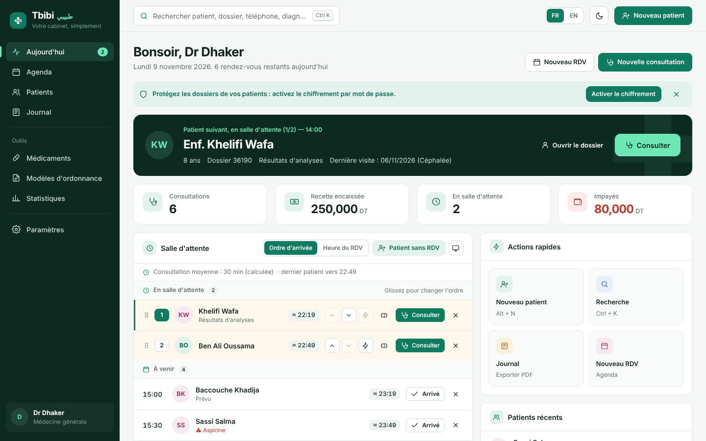
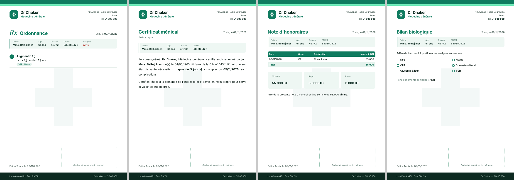

<p align="center"></p>

# Tbibi · طبيبي

**Logiciel de gestion de cabinet médical — simple, rapide, hors ligne.**
Medical practice software for doctors in Tunisia: patients, consultations, prescriptions, certificates, appointments and billing, in one HTML file that runs in the browser with no installation and no internet.

Tbibi replaces 2000s-era desktop software ("Mon Cabinet v2003" and similar). It keeps the workflow doctors already know (daily log, patient file, CNAM claim forms) and adds instant search, PDF documents and encrypted records.

- 🇫🇷 French interface by default, 🇬🇧 English switch
- Light and dark themes
- Works offline; data stays on the doctor's computer, encrypted if the doctor sets a password

**Try it online: <https://tbibi-tn.github.io/>** (demo data; everything you type stays in your own browser)

## Features

| Area | What the doctor gets |
|---|---|
| **Today** | Next patient card, waiting room you can reorder (drag, arrows, "see first"), arrival-order or appointment-time mode, walk-ins, ticket numbers, estimated time for each patient, day totals, unpaid balances |
| **Waiting room QR** | TV screen with tickets, times and a QR code; 80 mm tickets; patient phone page in French and Arabic (no names ever leave the app) |
| **Search** | `Ctrl K` searches patients, consultations, medications and appointments as you type, with category tabs |
| **Patient file** | Identity, CNAM details (APCI, pathway, unique ID), medical history, allergies, vital-sign charts, visit history, payments, duplicate detection |
| **Consultation** | Vital signs with abnormal values in orange, automatic BMI, diagnosis suggestions, prescriptions with autocomplete, templates, renew last prescription, allergy alerts, lab and imaging requests, fees and claim form |
| **Documents (PDF)** | Prescription, 7 certificate types, lab request, imaging request, referral letter, fee note, patient record, daily log, all with the doctor's own header |
| **Journal** | Daily log with revenue, cash collected, unpaid, with/without claim form; PDF and Excel export |
| **Calendar** | Weekly view, click a slot to book, appointment statuses |
| **Statistics** | Comparison with the previous period, revenue with and without claim form, visits per month, busiest days and hours, top diagnoses and medications, patients seen, unpaid balances; every chart has a table view |
| **Security** | AES-256 encryption with a password, lock screen, auto-lock, encrypted backups ([details](SECURITY.md)) |
| **Reliability** | IndexedDB storage sized for 10+ years of records, automatic consultation drafts, warning before losing unsaved work, save-failure alert |

<p align="center"></p>

## Getting started

### For doctors

1. Open <https://tbibi-tn.github.io/>, or download `dist/tbibi.html` and double-click it to use it with no internet.
2. Use a recent Chrome, Edge or Firefox.
3. Go to **Paramètres**: enter the name, specialty and address printed on documents, upload the practice logo and scanned stamp, and turn on **Sécurité → Activer le chiffrement**.
4. Click **Recharger les données de démonstration** to explore with fake patients, or **Effacer toutes les données** to start fresh.

Keep the file in the same place and always open it with the same browser: the data is saved in that browser's database on that computer (IndexedDB, enough for many years of records). Use **Télécharger une sauvegarde** regularly.

### For developers

Requires [Node.js](https://nodejs.org) 18 or newer.

```bash
npm install          # optional: esbuild (minified build) and Playwright (tests)
npm run build        # src/ -> dist/tbibi.html + docs/ (GitHub Pages)
npm test             # build + browser checks + screenshots in docs/screenshots/
npm run perf         # time every screen with 6,000 patients and 70,000 visits
```

The build needs no dependencies: `node scripts/build.mjs` inlines the CSS and the JavaScript modules into one HTML file (minified when esbuild is installed; `npm run build:plain` keeps it readable).

## Patient QR code (waiting room)

The QR code on the waiting-room screen and on tickets opens `attente.html`, a small page that shows the patient's number and estimated time. It carries only ticket numbers and times, never names.

On the online version (<https://tbibi-tn.github.io/>) this works with no setup.

When Tbibi is used from the downloaded file, set the address once so the QR code works on patients' phones: **Paramètres → Salle d'attente et QR code → Adresse de la page patient** → `https://tbibi-tn.github.io/attente/`. Without an address, the QR code opens the local copy (`dist/attente.html`) and only works on the practice computer. The page shows the moment the code was generated; live updates will come with the online service.

## Project structure

```
tbibi/
├── src/
│   ├── index.html            HTML shell + Content Security Policy
│   ├── attente.html          patient phone page opened by the QR code
│   ├── styles/main.css       design tokens (light/dark) and components
│   └── js/
│       ├── i18n.js           French / English strings
│       ├── data/             medication list, lab tests, demo data
│       ├── core/             state, utilities, IndexedDB storage (storage.js), encryption (security.js)
│       ├── ui/               icons, modals, autocomplete, shell, charts
│       ├── views/            one file per screen (today, journal, patients, visit…)
│       ├── pdf/              print engine and document templates
│       └── main.js           start-up
├── scripts/
│   ├── build.mjs             builds dist/ and docs/
│   └── modules.mjs           script load order
├── tests/
│   ├── smoke.test.mjs        end-to-end checks with Playwright
│   └── perf.mjs              speed check with a 10-year practice
├── dist/                     ready-to-use build: tbibi.html + attente.html
├── docs/                     GitHub Pages site (built): index.html = the app, attente/ = patient page
├── docs/screenshots/
├── CHANGELOG.md
└── SECURITY.md
```

Modules share globals and load in the order listed in `scripts/modules.mjs`. To add a screen, create `src/js/views/<name>.js`, add it to that list, register it in `render()` (`src/js/ui/shell.js`) and add its strings to both languages in `i18n.js`.

## Data and privacy

- No server, no account, no tracking. The Content Security Policy blocks every network request except Google Fonts.
- With encryption on, only an AES-256-GCM vault is stored; the password is never saved. A forgotten password cannot be recovered.
- Never commit real patient data or backups: `*.tbibi` and backup files are already in `.gitignore`.

Read [SECURITY.md](SECURITY.md) before deploying in a practice.

## Changelog

See [CHANGELOG.md](CHANGELOG.md). Current version: **1.4.1**.

## License

All rights reserved © 2026. Contact the author to use Tbibi in a practice.
